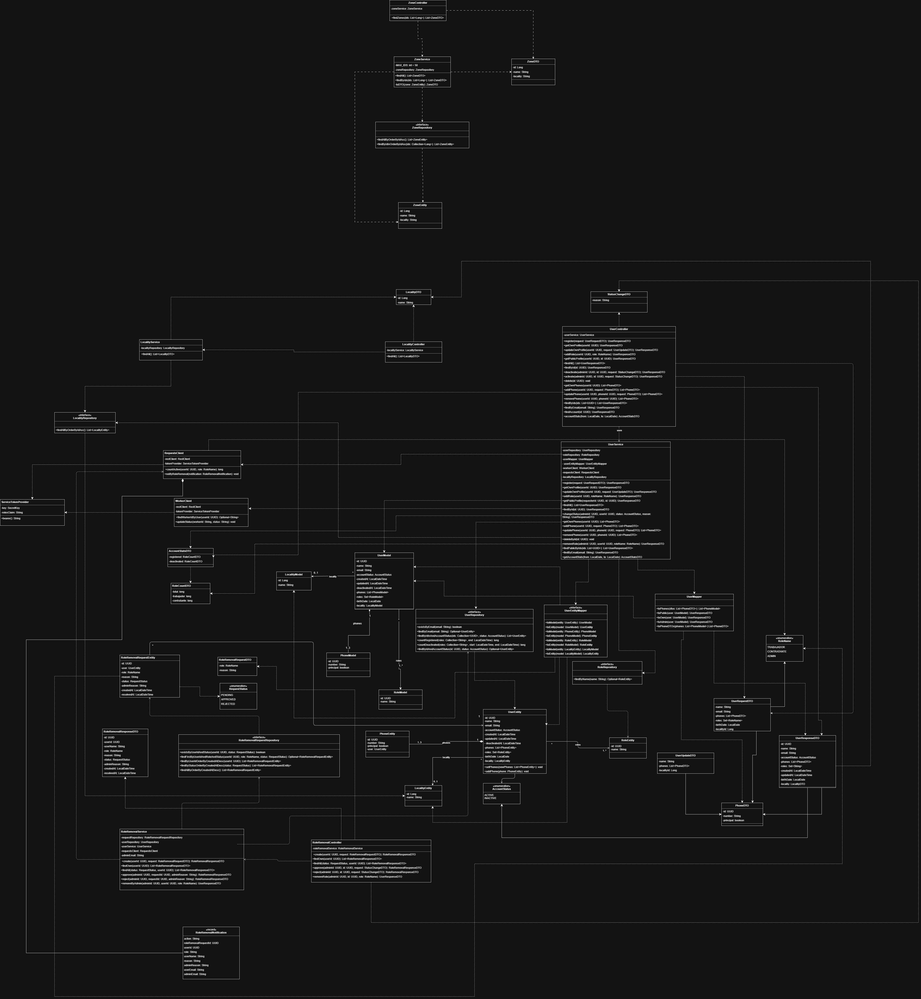
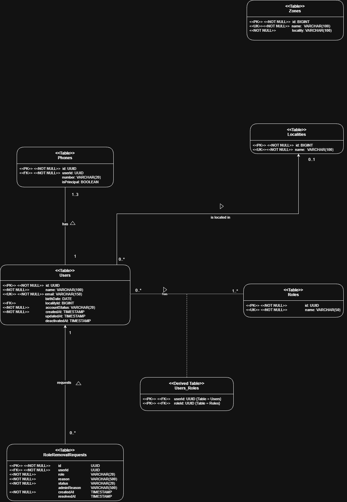

# oficioya-users

# Microservicio de usuarios

## Descripción
El microservicio de usuarios se encarga de gestionar la información general de la persona y su cuenta dentro de la plataforma, independientemente de si actúa como Contratante, Trabajador o ambos, o Administrador.

Por lo tanto, debe llevar a cabo qué campos de visualización debe tener el registro y perfil de la cuenta de los distintos usuarios especificándolos detalladamente.

## Alcance

* Registro de cuentas con rol TRABAJADOR y/o CONTRATANTE y fecha de nacimiento obligatoria (mayor de edad).
* Perfil propio, edición del perfil, teléfonos (máximo 3, uno principal) y perfil público de otros usuarios.
* Agregar el rol que falta. Para quitar un rol, el usuario lo pide con una razón y el administrador aprueba o rechaza la petición (o lo quita directamente), siempre que la cuenta conserve al menos un rol y no tenga solicitudes activas en ese rol.
* Administración: consulta de cuentas, desactivación y reactivación con motivo.
* Catálogo de zonas (barrios) y de localidades de Bogotá. La localidad es solo del contratante: solo él la elige o la cambia, y queda vacía si deja de ser contratante.
* Consultas para otros microservicios (Identity, Worker, Requests, Reporting).

Los requerimientos y criterios de aceptación completos están en [requirements.md](oficioYa-users/docs/requirements/requirements.md) y [acceptance-criteria.md](oficioYa-users/docs/requirements/acceptance-criteria.md).

## Tecnologías

* Java 21 y Spring Boot 3.3.4 (Web, Data JPA, Validation, Security)
* PostgreSQL (Azure) y H2 para pruebas
* JWT HS256 emitido por Identity (claim `roles` como lista)
* MapStruct y Lombok
* Swagger (springdoc)
* JUnit 5, Mockito y JaCoCo (cobertura mínima 80 %)
* GitHub Actions, SonarCloud y Azure App Service

## Endpoints

Base: `/api/v1`. Todos requieren token salvo los marcados como públicos.

| Método | Ruta | Acceso | RF |
|---|---|---|---|
| POST | `/users` | SERVICE | RF-01 |
| POST | `/users/me/roles/{role}` | Usuario | RF-02 |
| GET / PATCH | `/users/me` | Usuario | RF-03, RF-04 |
| GET / POST | `/users/me/phones` | Usuario | RF-04 |
| PATCH / DELETE | `/users/me/phones/{phoneId}` | Usuario | RF-04 |
| GET | `/users/{id}` | Usuario | RF-05 |
| GET | `/admin/users` y `/admin/users/{id}` | ADMIN | RF-08 |
| PATCH | `/admin/users/{id}/deactivate` y `/activate` | ADMIN | RF-06, RF-07 |
| GET | `/zones` | Público | RF-09 |
| GET | `/users?ids=` | Autenticado | RF-10 |
| GET | `/users/by-email` y `/users/{id}/account` | SERVICE | RF-11 |
| GET | `/users/stats/accounts?from=&to=` | ADMIN | RF-12 |
| POST / GET | `/users/me/role-removal-requests` | Usuario | RF-13 |
| GET | `/admin/role-removal-requests?status=&userId=` | ADMIN | RF-13 |
| PATCH | `/admin/role-removal-requests/{id}/approve` y `/reject` | ADMIN | RF-13 |
| DELETE | `/admin/users/{id}/roles/{role}` | ADMIN | RF-13 |
| GET | `/localities` | Público | RF-14 |
| DELETE | `/users/{id}` | SERVICE | Compensación |

Sin token se recibe 401 y con un rol que no corresponde se recibe 403. Los errores siempre responden con el formato `timestamp`, `status`, `error`, `message` y `route`.

Documentación interactiva: `/swagger-ui.html`.

## Ejecución local

Variables de entorno (ver [.env.example](oficioYa-users/.env.example)):

| Variable | Descripción |
|---|---|
| `DB_URL`, `DB_USERNAME`, `DB_PASSWORD` | Conexión a la base de datos |
| `JWT_SECRET` | Clave compartida con Identity, en Base64 |
| `WORKERS_URL`, `REQUESTS_URL` | URL de los microservicios de Worker y Requests |
| `ADMIN_EMAIL`, `ADMIN_NAME`, `ADMIN_PHONE` | Cuenta de administrador que se crea al iniciar |

Con H2 en memoria, sin instalar PostgreSQL:

```bash
cd oficioYa-users
# DB_URL=jdbc:h2:mem:oficioya  DB_USERNAME=sa  DB_PASSWORD=  JWT_SECRET=<Base64>
mvn spring-boot:run "-Dspring-boot.run.useTestClasspath=true"
```

La aplicación queda en `http://localhost:8080` y carga los catálogos de zonas y localidades desde `data.sql`.

## Pruebas y calidad

```bash
cd oficioYa-users
mvn clean verify
```

Ejecuta las pruebas unitarias, de integración y de aceptación, y valida la cobertura mínima de JaCoCo (80 %). El reporte queda en `target/site/jacoco/index.html`.

El pipeline de [GitHub Actions](.github/workflows/ci-cd.yml) compila, prueba, analiza en SonarCloud (Quality Gate) y, con cada push a `main`, despliega en Azure App Service.

## Postman

La colección [oficioya-users.postman_collection.json](oficioYa-users/docs/oficioya-users.postman_collection.json) cubre los escenarios de éxito y error de cada requerimiento.

1. Importar la colección.
2. Poner en la variable `jwtSecret` el mismo valor de `JWT_SECRET`. Los tokens de usuario, administrador y SERVICE se generan solos.
3. Ejecutar en orden con *Run collection*.

Cuando el administrador quita un rol, Users consulta las solicitudes activas en Requests y, si es TRABAJADOR, pausa el perfil en Worker; por eso esos microservicios deben estar disponibles.

Evidencias: [Swagger](oficioYa-users/docs/evidencias/swagger.png) y [ejecución en Postman](oficioYa-users/docs/evidencias/postman-run.png).

## Diagrama de clases



## Diagrama Entidad - Relación


