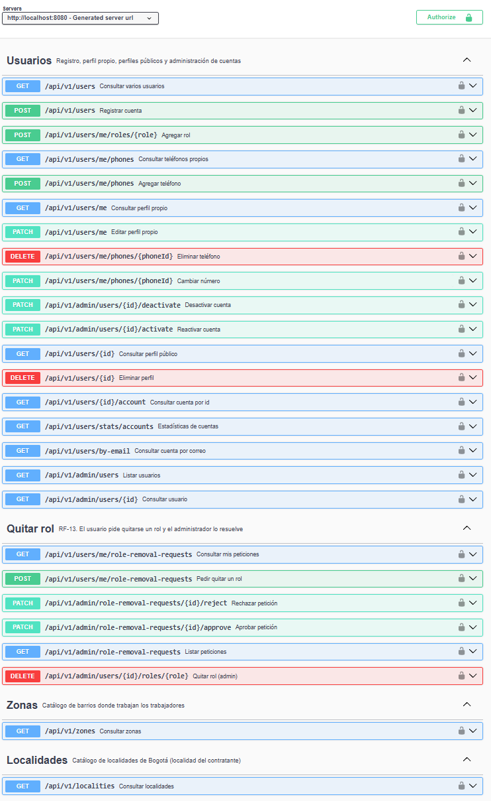

# Criterios de aceptación del microservicio de usuarios

Cada requerimiento funcional tiene sus criterios en formato **Dado / Cuando / Entonces**. Todos están automatizados en
[`UserAcceptanceTest`](../../src/test/java/edu/eci/dosw/oficioya_users/acceptance/UserAcceptanceTest.java), que levanta la
aplicación completa (seguridad JWT, controlador, servicio y base de datos H2) y llama a los endpoints como lo haría el front.

Para ejecutarlas:

```bash
mvn test -Dtest=UserAcceptanceTest
```

## Evidencias

Además de las pruebas automatizadas, la [colección de Postman](../oficioya-users.postman_collection.json) recorre los mismos
requerimientos con 40 peticiones, incluidos los endpoints de teléfonos, los que usa el Orquestador (rol `SERVICE`) y el catálogo de zonas.
Ejecutada completa (*Run collection*), pasan las 87 pruebas:


Documentación de los endpoints en Swagger (`/swagger-ui.html`):



## RF-01 Registrar cuenta (`POST /api/v1/users`)

| #  | Dado                                                              | Cuando                                                                                                                                      | Entonces                                                                                           |
|----|-------------------------------------------------------------------|---------------------------------------------------------------------------------------------------------------------------------------------|----------------------------------------------------------------------------------------------------|
| 1  | Un correo que no está registrado                                  | Me registro con nombre, un teléfono principal y el rol CONTRATANTE                                                                          | Recibo 201 y la cuenta queda Activa con ese rol y el correo enmascarado                            |
| 2  | Un correo que no está registrado                                  | Me registro como TRABAJADOR y CONTRATANTE                                                                                                   | La cuenta tiene ambos roles                                                                        |
| 3  | Un correo que no está registrado                                  | Me registro solo como TRABAJADOR                                                                                                            | La cuenta tiene únicamente ese rol                                                                 |
| 4  | Un correo ya registrado (sin importar mayúsculas)                 | Intento registrarme con él                                                                                                                  | Recibo 409                                                                                         |
| 5  | —                                                                 | Intento registrarme con el rol ADMIN                                                                                                        | Recibo 400                                                                                         |
| 6  | —                                                                 | Me registro con dos teléfonos principales                                                                                                   | Recibo 400                                                                                         |
| 7  | —                                                                 | Me registro con más de tres teléfonos o con datos inválidos (por ejemplo, un teléfono que no es un celular de 10 dígitos que empieza por 3) | Recibo 400                                                                                         |
| 8  | —                                                                 | Intento registrarme sin token o con un token que no es SERVICE                                                                              | Recibo 401 o 403                                                                                   |
| 9  | Un perfil creado cuyo registro falló en Identity                  | El Orquestador pide eliminarlo con token SERVICE                                                                                            | Recibo 204 y el perfil deja de existir; con otro rol recibo 403                                    |
| 10 | Un visitante mayor de edad                                        | Me registro con mi fecha de nacimiento (`birthDate`, AAAA-MM-DD)                                                                            | Recibo 201; mi edad se ve en mi perfil, la fecha en la vista del admin y nada en el perfil público |
| 11 | Un visitante que cumple 18 años hoy                               | Me registro                                                                                                                                 | Recibo 201                                                                                         |
| 12 | Un visitante menor de edad (le falta al menos un día para los 18) | Me registro                                                                                                                                 | Recibo 400 "Debes ser mayor de edad para registrarte"                                              |
| 13 | —                                                                 | Me registro con fecha de nacimiento de hoy, futura o anterior a 1900                                                                        | Recibo 400                                                                                         |
| 14 | —                                                                 | Me registro sin fecha de nacimiento                                                                                                         | Recibo 400 "La fecha de nacimiento es obligatoria"                                                 |
## RF-02 Agregar rol (`POST /api/v1/users/me/roles/{role}`)

| # | Dado                                                               | Cuando                             | Entonces                                                                                                     |
|---|--------------------------------------------------------------------|------------------------------------|--------------------------------------------------------------------------------------------------------------|
| 1 | Un contratante activo                                              | Agrega el rol TRABAJADOR           | Su cuenta tiene ambos roles, sin crear otra cuenta                                                           |
| 2 | Un trabajador activo                                               | Agrega el rol CONTRATANTE          | Su cuenta tiene ambos roles, sin crear otra cuenta                                                           |
| 3 | Un usuario que ya tiene el rol                                     | Lo vuelve a agregar                | Recibe 409                                                                                                   |
| 4 | Un usuario activo                                                  | Intenta agregarse el rol ADMIN     | Recibe 400                                                                                                   |
| 5 | El administrador                                                   | Intenta agregarse un rol           | Recibe 403                                                                                                   |
| 6 | Un contratante que antes fue trabajador (perfil pausado en Worker) | Vuelve a agregar el rol TRABAJADOR | Su cuenta tiene ambos roles y su perfil en Worker queda `ACTIVE`                                             |
| 7 | Un contratante sin perfil en Worker                                | Agrega el rol TRABAJADOR           | Su cuenta tiene ambos roles; no se llama a Worker para cambiar estado y el front lo lleva a `/worker/create` |
| 8 | Los microservicios Workers u Orquestador no responden               | Agrega el rol TRABAJADOR           | Recibe 503 y el rol no se agrega                                                                             |

## RF-03 Consultar perfil propio (`GET /api/v1/users/me`)

| # | Dado | Cuando | Entonces |
|---|------|--------|----------|
| 1 | Un usuario activo | Consulta su perfil | Ve sus datos con correo (`*****@mail.com`) y teléfono (`******4567`) enmascarados |
| 2 | — | Consulta el perfil sin token | Recibe 401 |

## RF-04 Editar perfil propio (`PATCH /api/v1/users/me`)

| # | Dado              | Cuando                            | Entonces                                                                          |
|---|-------------------|-----------------------------------|-----------------------------------------------------------------------------------|
| 1 | Un usuario activo | Cambia su nombre y sus teléfonos  | Quedan guardados el nombre nuevo y solo los teléfonos nuevos; el correo no cambia |
| 2 | Un usuario activo | Envía teléfonos sin uno principal | Recibe 400                                                                        |

### Teléfonos del perfil propio (`/api/v1/users/me/phones`)

Estos criterios están automatizados en [`UserServiceTest`](../../src/test/java/edu/eci/dosw/oficioya_users/service/UserServiceTest.java)
y [`UserControllerTest`](../../src/test/java/edu/eci/dosw/oficioya_users/controller/UserControllerTest.java).

| #  | Dado                                       | Cuando                                                                | Entonces                                                                              |
|----|--------------------------------------------|-----------------------------------------------------------------------|---------------------------------------------------------------------------------------|
| 3  | Un usuario activo                          | Consulta sus teléfonos para editarlos (`GET`)                         | Recibe sus teléfonos completos (sin enmascarar) con su id                             |
| 4  | Un usuario activo con menos de 3 teléfonos | Agrega un teléfono (`POST`)                                           | Queda guardado como adicional                                                         |
| 5  | Un usuario activo con 3 teléfonos          | Agrega otro teléfono                                                  | Recibe 400                                                                            |
| 6  | Un usuario activo                          | Agrega un número que ya tiene registrado                              | Recibe 409                                                                            |
| 7  | Un usuario activo                          | Agrega un número que no es un celular de 10 dígitos que empieza por 3 | Recibe 400 con el mensaje "Ingrese un teléfono válido"                                |
| 8  | Un usuario activo                          | Modifica el número de un teléfono (`PATCH /{phoneId}`)                | Queda guardado el número nuevo y el teléfono conserva su tipo (principal o adicional) |
| 9  | Un usuario activo                          | Modifica un teléfono que no existe                                    | Recibe 404                                                                            |
| 10 | Un usuario activo                          | Elimina un teléfono adicional (`DELETE /{phoneId}`)                   | El teléfono deja de estar en la cuenta                                                |
| 11 | Un usuario activo                          | Intenta eliminar el teléfono principal                                | Recibe 400                                                                            |

## RF-05 Consultar perfil público (`GET /api/v1/users/{id}`)

| # | Dado                                  | Cuando                     | Entonces                                              |
|---|---------------------------------------|----------------------------|-------------------------------------------------------|
| 1 | Otro usuario activo                   | Consulto su perfil         | Solo veo id, nombre y roles (sin correo ni teléfonos) |
| 2 | Un usuario desactivado                | Consulto su perfil público | Recibo 404                                            |
| 3 | Que mi propia cuenta está desactivada | Consulto un perfil público | Recibo 403                                            |

## RF-06 Desactivar cuenta (`PATCH /api/v1/admin/users/{id}/deactivate`)

| # | Dado                       | Cuando                                                        | Entonces                                                           |
|---|----------------------------|---------------------------------------------------------------|--------------------------------------------------------------------|
| 1 | Un usuario activo          | El admin lo desactiva con motivo                              | La cuenta queda Inactiva y el usuario recibe 403 al usar su perfil |
| 2 | Un usuario activo          | El admin lo desactiva sin motivo                              | Recibe 400                                                         |
| 3 | Una cuenta ya inactiva     | El admin la vuelve a desactivar                               | Recibe 409                                                         |
| 4 | El administrador           | Intenta desactivar su propia cuenta                           | Recibe 403                                                         |
| 5 | Un usuario que no es admin | Intenta desactivar una cuenta                                 | Recibe 403                                                         |
| 6 | Un usuario activo          | El admin lo desactiva con un motivo de menos de 10 caracteres | Recibe 400 (automatizado en `UserControllerTest`)                  |

## RF-07 Reactivar cuenta (`PATCH /api/v1/admin/users/{id}/activate`)

| # | Dado                 | Cuando                          | Entonces                                                    |
|---|----------------------|---------------------------------|-------------------------------------------------------------|
| 1 | Un usuario inactivo  | El admin lo reactiva con motivo | La cuenta queda Activa y el usuario vuelve a usar su perfil |
| 2 | Una cuenta ya activa | El admin la reactiva            | Recibe 409                                                  |

## RF-08 Consultar información completa (`GET /api/v1/admin/users`, `GET /api/v1/admin/users/{id}`)

| # | Dado                       | Cuando                           | Entonces                                             |
|---|----------------------------|----------------------------------|------------------------------------------------------|
| 1 | Un usuario registrado      | El admin lo consulta             | Ve correo, teléfonos, estado y fechas sin enmascarar |
| 2 | Cuentas registradas        | El admin lista los usuarios      | Aparecen las cuentas registradas                     |
| 3 | Un id que no existe        | El admin lo consulta             | Recibe 404                                           |
| 4 | Un usuario que no es admin | Consulta la información completa | Recibe 403                                           |

## RF-09 Consultar el catálogo de zonas (`GET /api/v1/zones`)

| # | Dado                                                           | Cuando                       | Entonces                                                                |
|---|----------------------------------------------------------------|------------------------------|-------------------------------------------------------------------------|
| 1 | —                                                              | Consulto las zonas sin token | Recibo 200 con los 25 barrios (id, nombre y localidad) ordenados por id |
| 2 | Unos ids, algunos repetidos o inexistentes (`?ids=13,2,2,999`) | Los consulto                 | Recibo solo las zonas que existen, sin repetidas y ordenadas por id     |
| 3 | —                                                              | Envío un id que no es número | Recibo 400                                                              |
| 4 | Más de 50 ids distintos                                        | Los consulto                 | Recibo 400 (automatizado en `ZoneServiceTest` y `ZoneControllerTest`)   |

## RF-10 Consultar varios usuarios a la vez (`GET /api/v1/users?ids=…`)

| # | Dado                                      | Cuando                                                          | Entonces                   |
|---|-------------------------------------------|-----------------------------------------------------------------|----------------------------|
| 1 | Cuentas activas                           | Las consulto por sus ids con cualquier rol (incluido `SERVICE`) | Recibo sus datos públicos  |
| 2 | Una cuenta inactiva o un id que no existe | Lo incluyo en los ids                                           | No aparece en la respuesta |
| 3 | Más de 50 ids                             | Los consulto                                                    | Recibo 400                 |
| 4 | —                                         | Consulto sin token                                              | Recibo 401                 |

## RF-11 Consultar la cuenta de un usuario (`GET /api/v1/users/by-email?email=…` y `GET /api/v1/users/{id}/account`)

| # | Dado                                      | Cuando                                                                                                                    | Entonces                                                                  |
|---|-------------------------------------------|---------------------------------------------------------------------------------------------------------------------------|---------------------------------------------------------------------------|
| 1 | Una cuenta registrada (Activa o Inactiva) | El Orquestador llama a Identity la consulta por correo (sin importar mayúsculas ni espacios) o por id con token `SERVICE` | Recibe sus datos completos: id, nombre, correo, teléfonos, roles y estado |
| 2 | Un correo o id que no existe              | Lo consulta                                                                                                               | Recibe 404                                                                |
| 3 | —                                         | Consulta con un token que no es `SERVICE` o sin token                                                                     | Recibe 403 o 401                                                          |

Automatizado en `UserServiceTest`, `UserControllerTest` y `UserRepositoryTest`.

## RF-12 Estadísticas de cuentas para Reporting (`GET /api/v1/users/stats/accounts?from=…&to=…`)

| # | Dado                                                               | Cuando                                                                                              | Entonces                                                                               |
|---|--------------------------------------------------------------------|-----------------------------------------------------------------------------------------------------|----------------------------------------------------------------------------------------|
| 1 | Cuentas registradas hasta la fecha de fin, algunas inactivas       | El administrador (vía Reporting) consulta el periodo                                                | `registered` cuenta todas, activas o no, en total y por rol (trabajador y contratante) |
| 2 | Una cuenta desactivada dentro del periodo y otra desactivada antes | Consulta el periodo                                                                                 | `deactivated` cuenta solo la desactivada dentro del periodo                            |
| 3 | Una cuenta con los roles trabajador y contratante                  | Consulta el periodo                                                                                 | Cuenta en los dos roles y una sola vez en el total                                     |
| 4 | Una cuenta creada después de la fecha de fin, o un administrador   | Consulta el periodo                                                                                 | No se cuentan                                                                          |
| 5 | —                                                                  | Consulta con `from` posterior a `to`, sin alguna de las fechas o con una fecha que no es AAAA-MM-DD | Recibe 400                                                                             |
| 6 | —                                                                  | Consulta con un token de otro rol (incluido `SERVICE`) o sin token                                  | Recibe 403 o 401                                                                       |

Automatizado en `UserServiceTest`, `UserControllerTest`, `UserRepositoryTest` y `UserAcceptanceTest` (RF-12).

## RF-13 El administrador quita un rol (`DELETE /api/v1/admin/users/{id}/roles/{role}`, peticiones en `/api/v1/users/me/role-removal-requests` y `/api/v1/admin/role-removal-requests`)

| #  | Dado | Cuando | Entonces |
|----|------|--------|----------|
| 1  | Un usuario con ambos roles | Pide quitar TRABAJADOR con una razón de 10 a 500 caracteres | Recibe 201 con la petición `PENDING`; sus roles no cambian |
| 2  | Un usuario | Pide quitar un rol sin razón o con menos de 10 caracteres | Recibe 400 |
| 3  | Un usuario | Pide quitar el rol ADMIN | Recibe 400 |
| 4  | Un usuario con un solo rol o sin ese rol | Pide quitarlo | Recibe 409 |
| 5  | Un usuario con una petición pendiente | Crea otra petición | Recibe 409 |
| 6  | Una cuenta inactiva o de administrador | Pide quitar un rol | Recibe 403 |
| 7  | Un usuario sin rol ADMIN | Intenta aprobar, rechazar o quitar un rol por los endpoints de admin | Recibe 403 |
| 8  | Una petición pendiente de TRABAJADOR con perfil en Worker | El admin la aprueba con motivo | Recibe 200 `APPROVED`; la cuenta solo tiene CONTRATANTE y su perfil en Worker queda `PAUSED` |
| 9  | Una petición pendiente | El admin la rechaza con motivo | Recibe 200 `REJECTED` con el motivo; la cuenta conserva sus roles |
| 10 | Una petición ya resuelta | El admin intenta aprobarla o rechazarla | Recibe 409 |
| 11 | Una petición pendiente y el usuario tiene solicitudes activas en ese rol | El admin la aprueba | Recibe 409 con el número de solicitudes activas; la petición sigue `PENDING` y no se llama a Worker |
| 12 | Servicios, Worker u Orquestador no responden | El admin aprueba o quita un rol | Recibe 503; la cuenta conserva sus roles y la petición sigue `PENDING` |
| 13 | Un usuario con ambos roles, sin petición | El admin quita CONTRATANTE desde el detalle (sin body) | Recibe 200 con la cuenta completa (vista de admin), que solo tiene TRABAJADOR |
| 14 | Un usuario con una petición pendiente de ese rol | El admin quita el rol desde el detalle | La petición queda `APPROVED` con un motivo fijo |
| 17 | Una cuenta inactiva con ambos roles | El admin le quita un rol | Recibe 200; la cuenta sigue inactiva |
| 18 | Una cuenta que no existe | El admin intenta quitarle un rol | Recibe 404 |
| 19 | Una cuenta de administrador | El admin intenta quitarle un rol | Recibe 403 |
| 20 | Un usuario | Llama al endpoint viejo `DELETE /api/v1/users/me/roles/{role}` | Recibe 405 |
| 15 | Un usuario con peticiones | Consulta sus peticiones | Recibe 200 con todas, las más recientes primero, con el estado y el motivo del admin |
| 16 | El admin | Lista peticiones con `status=PENDING` (y opcional `userId`) | Recibe 200 solo con las pendientes |

El token sigue trayendo el rol anterior hasta el próximo login; el front vuelve a iniciar sesión o refresca el token.
Automatizado en `RoleRemovalServiceTest`, `RoleRemovalControllerTest`, `UserServiceTest` (reglas al quitar el rol), `WorkerClientTest` y `RequestsClientTest` (Worker y Servicios simulados).
El token con el que se consulta el perfil en Worker (`GET /api/v1/workers/me`) lleva como `sub` el id del usuario; verificado en `WorkerClientTest`.

## RF-14 Localidad del trabajador y del contratante (`GET /api/v1/localities`, `localityId` en registro y edición)

| #  | Dado | Cuando | Entonces |
|----|------|--------|----------|
| 1  | — | Consulto el catálogo sin token | Recibo 200 con las 20 localidades de Bogotá ordenadas alfabéticamente |
| 2  | Un visitante con rol CONTRATANTE | Me registro con `localityId` de una localidad existente | Recibo 201 y mi perfil trae `locality: {id, name}` |
| 3  | Un visitante solo con rol TRABAJADOR | Me registro con `localityId` de una localidad existente | Recibo 201 y mi perfil trae `locality: {id, name}` |
| 4  | Un visitante | Me registro sin `localityId` | Recibo 400 "La localidad es obligatoria" |
| 5  | Un trabajador o contratante | Me registro o edito mi perfil con un `localityId` inexistente | Recibo 400 y no se guarda nada |
| 6  | Un trabajador o contratante activo | Cambio mi `localityId` en `PATCH /users/me` | Recibo 200 con la nueva localidad |
| 7  | El administrador | Intento cambiar mi `localityId` | Recibo 403 y no se guarda nada; sí puedo editar nombre y teléfonos |
| 8  | Un usuario con ambos roles y localidad | El administrador le quita el rol CONTRATANTE (RF-13) | Conserva su localidad |
| 9  | Un usuario con ambos roles y localidad | El administrador le quita el rol TRABAJADOR (RF-13) | Conserva su localidad |
| 10 | — | Consulto `GET /localities/{id}/workers` (se quitó: Worker ubica a sus trabajadores por barrio) | Recibo 404 |

Automatizado en `UserServiceTest`, `LocalityServiceTest` y `UserAcceptanceTest` (RF-14).